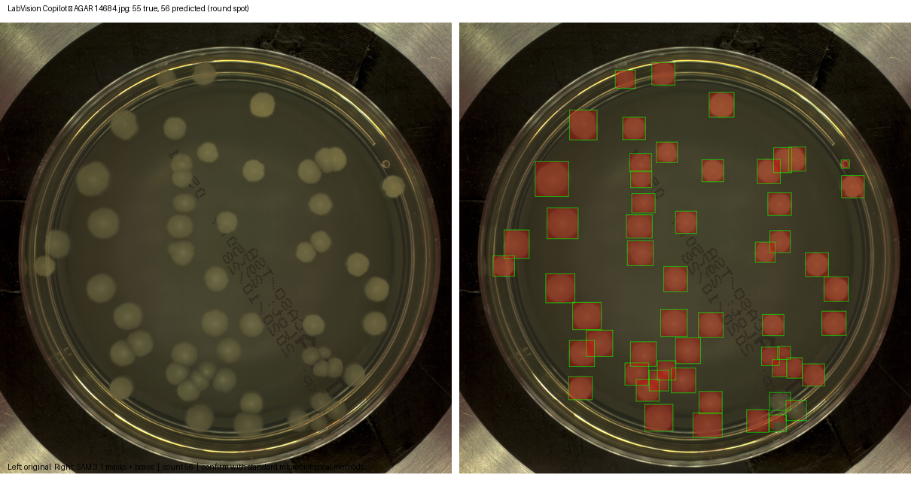
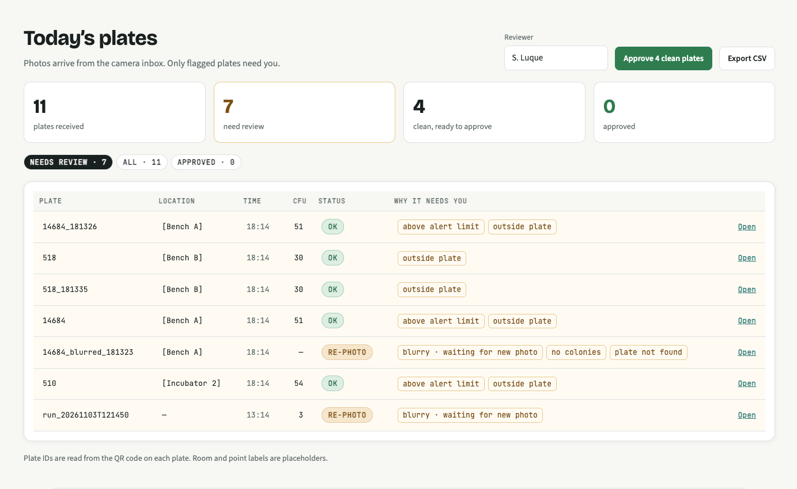
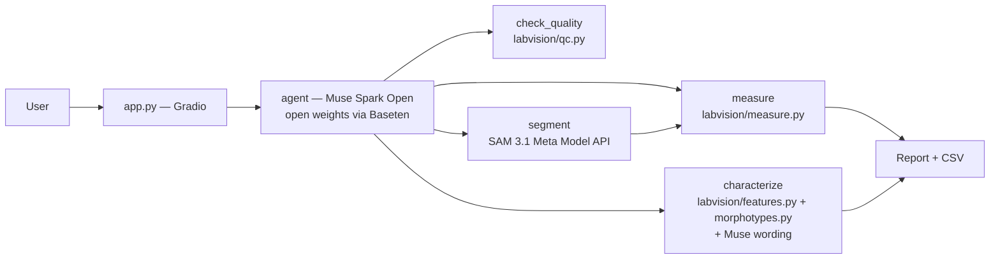

# LabVision Copilot

Plate photo + plain request → colony count you can audit.





## Built during the hackathon

Everything in this repository was built **Oct 27 – Nov 4 2026** as a solo entry in the Meta Global AI Developer Hackathon (Indie track). See the dated [BUILD_LOG.md](BUILD_LOG.md) for what was built and when. How it was built: [docs/process/](docs/process/) — plan, per-session instruction files, and design mockups.

## What it does

- **Count colonies / cells** with SAM 3.1 from a short noun phrase (e.g. `round spot`).
- **Measure in Python** — counts, areas, equivalent diameters come from `labvision/measure.py`; numbers never come from the model. Pixel size → mm via plate diameter detected in Python with OpenCV HoughCircles (90 mm plate, otherwise px with a note).
- **Quality checks** — blur (Laplacian variance), glare (saturated pixels), empty, crowded.
- **TNTC** — counts >300 → “Too numerous to count (>300 CFU): dilute and re-plate”.
- **Self-check retry** — if SAM returns 0 but the image is sharp, retry once with the alternate prompt `colonies`.
- **Descriptive colony-type table** — Python features (Lab colour minus agar background, circularity, log diameter, texture) are clustered in Python (fixed global scales, average linkage); Muse Spark Open writes a short description per group from a constrained vocabulary (colours, shapes, margins, elevations, surfaces). The table is descriptive only.
- **Voice input** — click the mic, say “count colonies larger than 2 mm” hands-free (gloves, biosafety cabinet); Muse Voice Transcribe fills the request box.
- **Human in the loop** — draw a box around a missed colony (SAM box/point prompt) in the Result tab; accepted only if it contrasts with the surrounding agar (“No colony visible here” otherwise). Removing a false detection and every edit is logged separately from model output.
- **Sanity guards** — duplicates (IoU), plate size check (40–98% of image), implausible sizes (0.1–15 mm flagged), dense-plate undercount flag.
- **Audit log + CSV** — every run writes `run.json` (inputs, model ids, params, including voice transcript and corrections) and `results.csv`.

## Where it fits — a module, not a monolith



- **Labs with automated incubators/imagers**: the device's software sends each plate image to `POST /api/analyze` and receives `{count, masks, status, run_id}` + `GET /api/runs/{id}` (trace with `decided_by: rule` for inbox, `model` for streaming) and `GET /api/export.csv` for LIMS import. The agent runs as a service behind the API — no UI needed.
- **Small labs without automation**: any camera (phone on a stand, USB camera) saves photos into `./inbox` (poll every 2 s, size unchanged for 2 s, temp+rename; QR code → plate ID else filename; optional sidecar `{location, sample_type, alert_limit}` — *example values only*). LabVision picks them up (`python server.py --inbox ./inbox` or `python -m labvision.inbox ./inbox`), runs the fixed pipeline (`count colonies`, `decided_by: rule`), and the technician only reviews flagged plates in the queue at `/app/queue`. No camera? **Upload plates** in the queue analyses a whole batch the same way.

Diagram:

```
Automated: [Imager] ─POST /api/analyze─▶ [LabVision] ─count+masks+trace─▶ [LIMS]
Small lab:  [Camera] ─▶ inbox/ ─poll▶ [LabVision] ─▶ queue (Re-photo/TNTC/Empty/alert/low conf c<0.5) ─Approve─▶ export.csv
```

Review-by-exception: blurry/glare → **Re-photo** (amber), TNTC (>300) → **TNTC** (amber), empty → **Empty** (grey), count ≥ *example* alert_limit, experimental/retry, low SAM confidence (mean `c` < 0.5) → coloured chips; sorted **Needs review** first, live refresh 3 s, click row → detail with click/box correction, reviewer name remembered in `localStorage`, `Approve` (human audit) + `Approve all clean plates`.

## Integrating with an incubator/imager or LIMS

- `POST /api/analyze` — multipart `image` + `request` (e.g. `count colonies`) → `{run_id, count, count_label, status: OK|Re-photo|TNTC|Empty, image_url, masks_url, boxes, measurements, trace: [{name, status, decided_by, mean_confidence}], report, csv_url}`
- `GET /api/runs/{id}` → same shape for a stored run (audit: `inputs.plate_id`, `inputs.location`, `params.plate_id`, `params.status`, `params.mean_confidence`)
- `GET /api/export.csv?from=2026-11-01T00:00:00Z&to=2026-11-02T00:00:00Z` → `plate_id,location,time,count,status,reasons,reviewed_by,reviewed_at,run_id` (one row per run, for LIMS; alert limits are *example values only*)
- `POST /api/batch` — multipart `images` (up to 50 JPG/PNG/TIFF) → `{batch_id, accepted, rejected}`; each plate runs the same fixed pipeline as the inbox (`count colonies`, `decided_by: rule`) in the background and appears in `/app/queue`. Same as the **Upload plates** button in the queue.
- `POST /api/runs/{id}/approve` `{reviewer: "Name"}` → audit `approval.json` + `run.json:audit` with `decided_by: human`, `final_count`
- OpenAPI docs at `/docs` — every endpoint has `summary` + example.

## Architecture



> **Verifiable agent:** every number in a report comes from deterministic Python. The model writes only the short interpretation. “Numbers come from Python, never from the model.”

## Verification layer

Agent must finish with `submit_report {summary, count, filters, notes}`. Code checks (not the model) every turn:

| Check | Fail → |
|---|---|
| `count` equals `measure` count (same filters); every number in `summary` is in measured results | refused, feedback |
| QC blur/glare → must be escalated `needs_rephoto` | refused |
| Count <30 → must say “too few”, >300 → “TNTC” | refused |
| Prompt is `round spot`/`colonies`/`cell` or report marked `experimental` | refused |
| No organism names, no `diagnosis`/`diagnose` | refused |

3 refusals → `report_refused` escalation (reviewer guidance). Pass → `awaiting_signoff` (approve/reject). QC fail → `needs_rephoto` (new photo with same QR/plate_id in `./inbox` auto-resumes). Loop: one tool/turn, turn limit 8, `paused` on API error, progress saved every turn in `runs/<id>/progress.json`, system instructions in `labvision/system_instructions.md`. See [VERIFICATION.md](VERIFICATION.md) + [ESCALATION_RULES.md](ESCALATION_RULES.md). Tests use scripted fake model (`tests/fake_model.py`) with recorded SAM outputs.

## Results

Held-out evaluation (dev/test split by image name, so test plates were never used for tuning).

- **AGAR** (real plates, 20 test images): **mean error 11.8% per plate**, **6/20 exact**. Best SAM prompt on dev was `round spot` (MAE 3.05) vs `bacterial colony` (MAE 34.05); test MAE 17.7. One dense plate (298 colonies) was under-counted (31) — tiling and plate-crop did not help on dev.
- **BBBC005** (synthetic cells, 200 in-focus `F1` images): **w1 (cell body) MAE 5.48**, **w2 (nuclei) MAE 18.95** (prompt `cell` for both; `nucleus` was worse at 52.6).

Full tables in [bench/RESULTS.md](bench/RESULTS.md); raw counts in `bench/results.csv`. See the *Honest limits* section below for what did not work.

## Honest limits (verifiable-agent section)

- **Muse Spark Open declines organism identification** on safety grounds (biological-risk policy). We do not name organisms/species and do not provide a diagnosis. Raw refusals are logged locally in `runs/characterize_raw/` (not in the repo).
- **The mixed-culture flag was removed.** We tried flagging mixed plates from morphology; on test it scored **80%** (16/20) vs the trivial “always pure” baseline **90%** (18/20 pure), and missed the one `Contamination` plate. A rule fixed in advance removed the flag when it did not beat the baseline. Details in `bench/morphotypes_v2_metrics.json`; n=20 is small.
- **Dense plates** — plates over 300 are TNTC; dense plates with few detections (e.g. AGAR 518: 298 true, 31 found) are flagged “possible undercount” for review, never OK.
- **Small n** — AGAR test is 20 plates; BBBC005 is 200 synthetic images.

## Meta models used

- **SAM 3.1** — `sam-3.1` on the Meta Model API (text/box/point prompts, one-bit mask encoding) for segmentation.
- **Muse Spark Open** — `meta-models/muse-spark-open-1026` via Baseten (chat + vision) for the agent planner and for per-group wording. Open-weights model.
- **Muse Voice Transcribe** — `muse-voice-transcribe-1.0` on the Meta Model API (WAV mono 24 kHz) for hands-free use — speak the request with gloves on in a biosafety cabinet; the transcript fills the request box for editing.

No other models are called at runtime.

## Deploy (one command, two pages + queue)

- `python server.py` → `http://127.0.0.1:8000` landing, `http://127.0.0.1:8000/app` dashboard, `/app?example=14684` preloads that plate. `python app.py` (Gradio) stays as fallback on `:7860`.
- `python server.py --inbox ./inbox` + `python scripts/simulate_camera.py --inbox ./inbox` → `http://127.0.0.1:8000/app/queue` live queue (review by exception, Approve → LIMS CSV at `GET /api/export.csv`).

## Responsible use

Research and QC quantification (pharma, food/water, teaching) with human review. Not a medical device. Do not use for clinical decisions. No medical advice. If you see unexpected results, re-photo and check the verification panel.

## Data

Only public or synthetic data is used. No dataset images are committed to the repository; only the UI screenshots in `docs/img/` and `web/img/` (the demo plate is AGAR 14684, CC BY-NC 2.0, credited below).

- **BBBC005** — synthetic cell images, CC0, via the Broad Bioimage Benchmark Collection.
- **AGAR** higher- and lower-resolution sample — CC BY-NC 2.0, Majchrowska et al. 2021, *AGAR: annotated dataset for automatic detection of colonies* (arXiv:2108.01234). Citations and licence checks in [data/README.md](data/README.md).

## Setup + run

```bash
python -m venv .venv && source .venv/bin/activate
pip install -r requirements.txt
cp .env.example .env  # fill META_API_KEY (SAM 3.1 + Voice) and BASETEN_API_KEY/BASETEN_BASE_URL (Muse Spark Open)
# SAM 3.1 + Voice Transcribe use META_API_KEY; Muse Spark Open uses BASETEN_*
python server.py               # → http://127.0.0.1:8000/ (landing) and /app (dashboard)
python server.py --inbox ./inbox                     # poll inbox (QR, 2 s stability, temp+rename) + queue at /app/queue
python scripts/simulate_camera.py --inbox ./inbox --count 10 --interval 3  # demo: fills inbox (dense 518 TNTC + blurred Re-photo)
python app.py                  # fallback Gradio on http://127.0.0.1:7860
python bench/run_bench.py      # counts vs ground truth (uses cache if present)
python bench/run_morphotypes_v2.py  # morphotype benchmark (GT boxes, no SAM)
```

Keys are read from environment only and never logged. Every external call is cached by input hash in `runs/cache/`, so reruns are free.

## Try it in 5 minutes

1. `python server.py` → open `http://127.0.0.1:8000/` (landing) then **Try an example plate** → plate loads in `/app?example=14684`.
2. Press **Run** → watch **How it was verified** tick live (✓/!/✕ + model/rule badges) and see the count, viewer, and report.
3. Draw a box around a missed colony → count updates (SAM point/box prompt); remove a false detection the same way.
4. Stop the server and restart it with `--inbox ./inbox`, then in a second terminal run the camera simulator `python scripts/simulate_camera.py --inbox ./inbox` → open `/app/queue`, set reviewer name, **Approve** a plate, **Export CSV** for LIMS.
5. Try `is this plate countable?` or `count black colonies (experimental)` → check the countable verdict / experimental banner and that numbers still come from Python.

## License

MIT. See [LICENSE](LICENSE). Third-party models and datasets keep their own licences.
