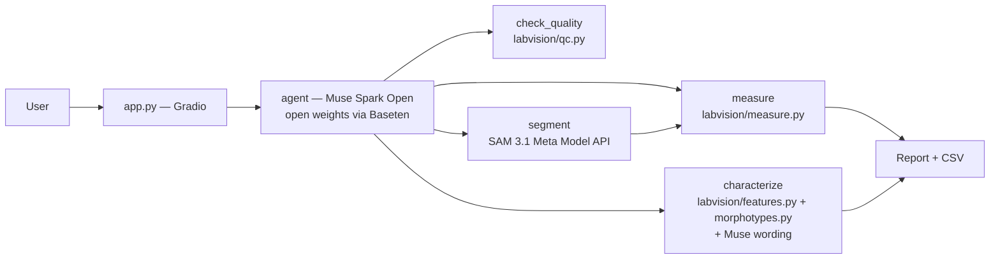

# LabVision Copilot

Plate photo + plain request → colony count you can audit.


## Built during the hackathon

Everything in this repository was built **Oct 27 – Nov 4 2026** as a solo entry in the Meta Global AI Developer Hackathon (Indie track). See the dated [BUILD_LOG.md](BUILD_LOG.md) for what was built and when.

## What it does

- **Count colonies / cells** with SAM 3.1 from a short noun phrase (e.g. `round spot`).
- **Measure in Python** — counts, areas, equivalent diameters come from `labvision/measure.py`; numbers never come from the model. Pixel size → mm via plate diameter detected in Python with OpenCV HoughCircles (90 mm plate, otherwise px with a note).
- **Quality checks** — blur (Laplacian variance), glare (saturated pixels), empty, crowded.
- **TNTC** — counts >300 → “Too numerous to count (>300 CFU): dilute and re-plate”.
- **Self-check retry** — if SAM returns 0 but the image is sharp, retry once with the alternate prompt `colonies`.
- **Descriptive colony-type table** — Python features (Lab colour minus agar background, circularity, log diameter, texture) are clustered in Python (fixed global scales, average linkage); Muse Spark Open writes a short description per group from a constrained vocabulary (colours, shapes, margins, elevations, surfaces). The table is descriptive only.
- **Voice input** — click the mic, say “count colonies larger than 2 mm” hands-free (gloves, biosafety cabinet); Muse Voice Transcribe fills the request box.
- **Audit log + CSV** — every run writes `run.json` (inputs, model ids, params, including voice transcript) and `results.csv`.

## Architecture



> **Verifiable agent:** every number in a report comes from deterministic Python. The model writes only the short interpretation. “Numbers come from Python, never from the model.”

## Results

Held-out evaluation (dev/test split by image name, so test plates were never used for tuning).

- **AGAR** (real plates, 20 test images): **mean error 11.8% per plate**, **7/20 exact**. Best SAM prompt on dev was `round spot` (MAE 3.05) vs `bacterial colony` (MAE 34.05); test MAE 17.7. One dense plate (298 colonies) was under-counted (31) — tiling and plate-crop did not help on dev.
- **BBBC005** (synthetic cells, 200 in-focus `F1` images): **w1 (cell body) MAE 5.48**, **w2 (nuclei) MAE 18.95** (prompt `cell` for both; `nucleus` was worse at 52.6).

Full tables in [bench/RESULTS.md](bench/RESULTS.md); raw counts in `bench/results.csv`. See the *Honest limits* section below for what did not work.

## Honest limits (verifiable-agent section)

- **Muse Spark Open declines organism identification** on safety grounds (biological-risk policy). We do not name organisms/species and do not provide a diagnosis. Raw refusals are logged in `runs/characterize_raw/`.
- **The mixed-culture flag was removed.** We tried flagging mixed plates from morphology; on test it scored **80%** (16/20) vs the trivial “always pure” baseline **90%** (18/20 pure), and missed the one `Contamination` plate. A rule fixed in advance removed the flag when it did not beat the baseline. Details in `bench/morphotypes_v2_metrics.json`; n=20 is small.
- **Dense plates (>300)** are reported as TNTC. Counting fails on very dense plates (e.g. AGAR 518.jpg).
- **Small n** — AGAR test is 20 plates; BBBC005 is 200 synthetic images.

## Meta models used

- **SAM 3.1** — `sam-3.1` on the Meta Model API (text/box/point prompts, one-bit mask encoding) for segmentation.
- **Muse Spark Open** — `meta-models/muse-spark-open-1026` via Baseten (chat + vision) for the agent planner and for per-group wording. Open-weights model.
- **Muse Voice Transcribe** — `muse-voice-transcribe-1.0` on the Meta Model API (WAV mono 24 kHz) for hands-free use — speak the request with gloves on in a biosafety cabinet; the transcript fills the request box for editing.

No other models are called at runtime.

## Responsible use

Research and QC quantification (pharma, food/water, teaching) with human review. Not a medical device. Do not use for clinical decisions. No medical advice. If you see unexpected results, re-photo and check the verification panel.

## Data

Only public or synthetic data is used. No images are committed to the repository except the demo screenshot above.

- **BBBC005** — synthetic cell images, CC0, via the Broad Bioimage Benchmark Collection.
- **AGAR** higher- and lower-resolution sample — CC BY-NC 2.0, Majchrowska et al. 2021, *AGAR: annotated dataset for automatic detection of colonies* (arXiv:2108.01234). Citations and licence checks in [data/README.md](data/README.md).

## Setup + run

```bash
python -m venv .venv && source .venv/bin/activate
pip install -r requirements.txt
cp .env.example .env  # fill META_API_KEY, BASETEN_API_KEY, BASETEN_BASE_URL
# SAM 3.1 uses META_API_KEY; Muse Spark Open + Voice use BASETEN_*
python app.py                  # → http://127.0.0.1:7860
python bench/run_bench.py      # counts vs ground truth (uses cache if present)
python bench/run_morphotypes_v2.py  # morphotype benchmark (GT boxes, no SAM)
```

Keys are read from environment only and never logged. Every external call is cached by input hash in `runs/cache/`, so reruns are free.

## License

MIT. See [LICENSE](LICENSE). Third-party models and datasets keep their own licences.
